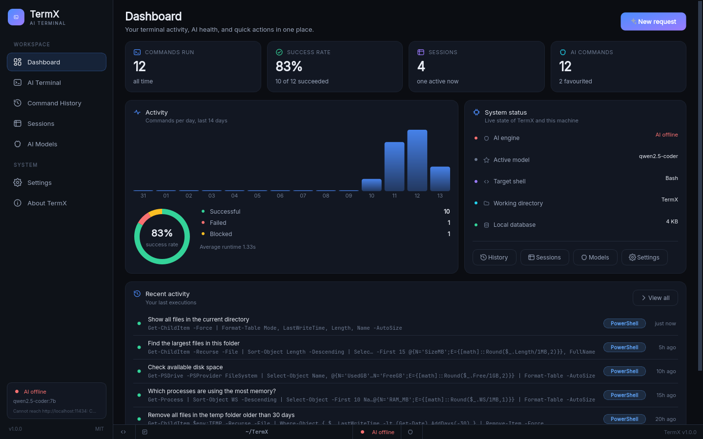
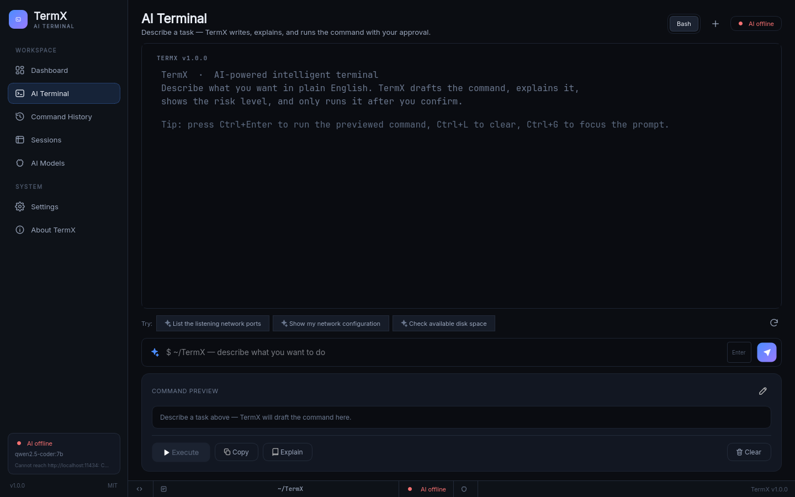
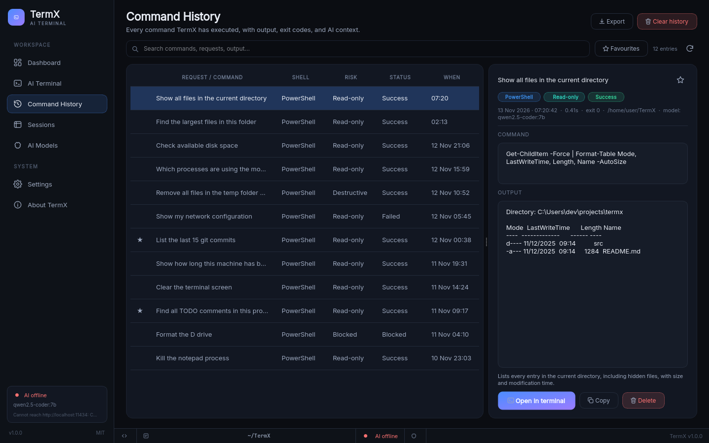
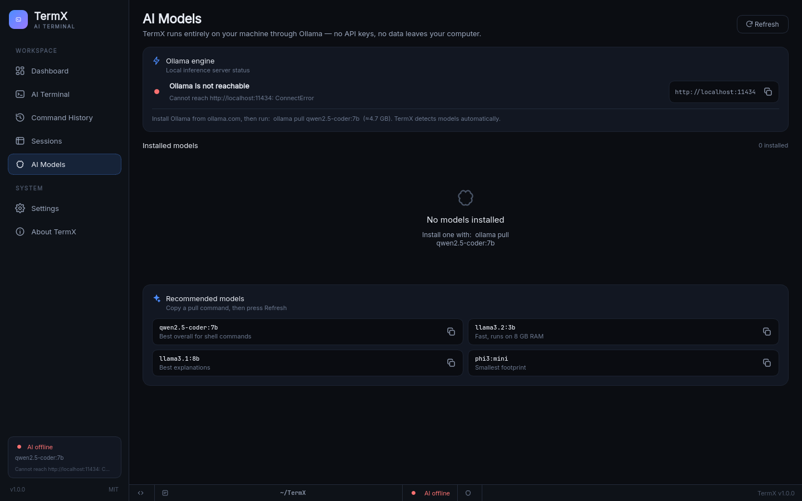

<div align="center">

# TermX

**Describe the task. TermX writes the command, explains it, and runs it only after you say yes.**

A native Windows terminal assistant built with Python, PySide6 and a local LLM via Ollama.
No cloud, no telemetry, no Docker — everything runs on your machine.

[](https://www.python.org/)
[](https://doc.qt.io/qtforpython/)
[](https://ollama.com)
[](LICENSE)

</div>

---

## Why TermX

PowerShell is powerful and forgettable. Everyone knows *what* they want to do — "find the biggest files
in this folder", "which process is eating my RAM", "clean up the temp directory" — but not the exact
syntax, flags, or pipe chain.

TermX closes that gap without handing an LLM an open shell:

1. You type what you want in plain English.
2. A **local** model drafts the command — or TermX's built-in offline library does, if Ollama is down.
3. A deterministic **safety analyser** grades the command (safe / caution / destructive / blocked)
   independently of what the model claims.
4. You see the command, its explanation, and its risk **before** anything runs.
5. Nothing executes without an explicit confirmation.
6. Output is captured live; if it fails, TermX explains *why* and suggests a safe correction.
7. Every session and command is remembered in a local SQLite database you can search, favourite and export.

## Features

| | |
|---|---|
| **AI command generation** | Natural language → PowerShell, CMD, Bash or Zsh, with explanations and alternatives. |
| **Static safety engine** | ~70 rules covering disk wipes, recursive deletes, credential exposure, remote code execution and more. The analyser always overrides the model. |
| **Guaranteed confirmation** | Commands are previewed with their risk level; destructive ones require an explicit second confirmation. Blocked commands cannot be run at all. |
| **Live output capture** | Streaming stdout/stderr, exit codes, timing, ANSI colours, and output size limits. |
| **Error diagnosis** | Failed commands are explained with a likely cause and concrete next steps — AI-first, with a built-in rule engine as fallback. |
| **Session memory** | Sessions, full command history, favourites, search, JSON/CSV/Markdown export, retention limits. |
| **Offline mode** | 25+ built-in intents mean TermX is useful with Ollama stopped. |
| **Premium dark UI** | Sidebar workspace, dashboard health metrics, command preview panel, toasts, keyboard shortcuts. |
| **CLI** | `termx doctor`, `termx run`, `termx ask`, `termx history` — same core services as the GUI. |

## Screenshots

<div align="center">

| Dashboard | AI Terminal |
|---|---|
|  |  |

| Command History | AI Models |
|---|---|
|  |  |

</div>

## Requirements

- **Windows 10/11** (TermX also runs on Linux and macOS — Bash/Zsh)
- **Python 3.12+** (for running from source)
- **[Ollama](https://ollama.com/download)** with at least one model pulled, e.g.

  ```powershell
  ollama pull qwen2.5-coder:7b
  ```

  Ollama is optional: without it TermX falls back to its offline command library and says so in the UI.

## Install

### Option A — Windows installer / portable build

Download the latest release and run `TermX.exe`. No Python installation required.

### Option B — from source

```powershell
git clone https://github.com/pooria683/TermX.git
cd TermX

python -m venv .venv
.venv\Scripts\activate

pip install -e .
python -m termx
```

On Linux/macOS the same steps work with `source .venv/bin/activate`.

### Option C — build the executable yourself

```powershell
pip install -e ".[build]"
pyinstaller TermX.spec --noconfirm
# → dist/TermX/TermX.exe
```

## Quick start

```powershell
ollama serve                       # in one terminal (if not already running)
python -m termx                    # in another
```

Then, in the AI Terminal:

```
describe a task, e.g.  "find the 10 largest files in this folder"
      ↓
TermX drafts          Get-ChildItem -Recurse -File |
                      Sort-Object Length -Descending |
                      Select-Object -First 10 FullName, Length
      ↓
you review risk       ✓ Read-only    No system changes
      ↓
Execute  →  output streams into the terminal  →  saved to history
```

### Keyboard shortcuts

| Shortcut | Action |
|---|---|
| `Ctrl+Enter` | Generate (in the prompt) / execute (in the preview) |
| `Ctrl+L` | Clear the terminal |
| `Ctrl+G` | Focus the prompt |
| `Ctrl+1 … Ctrl+7` | Jump to a page |
| `Esc` | Cancel generation or an in-flight command |

### Command-line interface

```console
$ termx doctor
CHECK        STATUS DETAIL
Python       ok     3.12.4
PySide6      ok     6.8.3
Ollama       ok     Ollama reachable — 3 models installed
Shells       ok     PowerShell, CMD

$ termx run "show disk usage per folder" --shell powershell
$ termx ask "what does Get-ChildItem -Force do?"
$ termx history --limit 20
```

## Safety model

TermX assumes the model can be wrong, manipulated, or hallucinate. Risk is therefore decided by
**static analysis of the command string**, never by the model's self-assessment.

| Level | Meaning | Behaviour |
|---|---|---|
| **Safe** | Read-only (`Get-ChildItem`, `git status`, `df`…) | Runs after the normal confirmation. |
| **Caution** | Modifies state, installs packages, touches the network | Runs after confirmation, warning shown. |
| **Destructive** | Recursive deletes, dropped databases, ownership changes | Requires an explicit second confirmation. |
| **Blocked** | Drive/disk wipes, `format`, `mkfs`, `dd` to a device, fork bombs | Cannot be executed at all. |

Example rules: `rm -rf /`, `Remove-Item -Recurse -Force /`, `format D:`, `Format-Volume`,
`diskpart … clean`, `del /f /s /q C:\*`, `dd of=/dev/sda`, `mkfs.*`, `Clear-Disk`,
`Set-MpPreference -Disable*`, piping remote scripts into an interpreter, and encoded PowerShell
payloads. The analyser also inspects every segment of a pipeline separately, so
`Get-ChildItem | Remove-Item -Recurse` is caught.

> **Exit codes and stderr are always captured**, so "it looked like it worked" never goes unnoticed.

## Configuration

Settings live in the app (Settings page, persisted to SQLite) or in
`%APPDATA%\TermX\settings.json`-style storage managed by `termx.get_user_data_dir()`:

| Setting | Default | Notes |
|---|---|---|
| Ollama host | `http://localhost:11434` | Any reachable Ollama endpoint. |
| Model | `qwen2.5-coder:7b` | Model list is discovered from `/api/tags`. |
| Temperature | `0.15` | Low by default: command generation should be deterministic. |
| Confirmation | on | Never disable for destructive commands. |
| Offline fallback | on | Use the built-in library when the model is unreachable. |
| History retention | 2000 rows | Favourites are never pruned. |

Environment variables: `OLLAMA_HOST` (honoured by the client) and `TERMX_DATA_DIR` (override the
data directory, handy for portable installs).

## Project layout

```
termx/
├── core/                  # Framework-agnostic domain layer (no Qt imports)
│   ├── models.py          # Pydantic v2 models shared by every layer
│   ├── safety.py          # Deterministic risk analyser (~70 rules)
│   ├── shell.py           # Shell launch specs, execution, streaming, timeouts
│   ├── database.py        # Thread-safe SQLite (WAL) storage + export
│   ├── ollama.py          # HTTPX client for the Ollama HTTP API
│   ├── prompts.py         # Prompt templates for generation/explanation/diagnosis
│   ├── offline.py         # Offline command library + error rules
│   └── ai_service.py      # AI orchestration, parsing, validation, fallbacks
├── ui/
│   ├── theme.py           # Palette, Qt stylesheet, typography
│   ├── controller.py      # AppController + QThread workers (queued signals)
│   ├── main_window.py     # Shell: sidebar, pages, status bar, toasts
│   ├── widgets/           # Reusable components (cards, badges, charts, terminal…)
│   └── pages/             # Dashboard, AI Terminal, History, Sessions, Models, Settings, About
├── cli.py                 # doctor / run / ask / history
└── __main__.py            # python -m termx
```

**Design rules that keep it maintainable**

- `core/` never imports Qt, so the whole pipeline is testable headlessly and reusable from the CLI.
- Every AI response is validated by Pydantic *and* re-checked by the safety analyser.
- Background work runs in `QThread` subclasses; worker signals are delivered to the GUI thread with
  `Qt.ConnectionType.QueuedConnection`, so no widget is ever touched off the main thread.
- Shutdown is explicit and ordered (window → workers → database), which avoids the teardown crashes
  common to PySide apps.

## Development

```bash
pip install -e ".[dev]"

pytest                      # core + GUI tests (headless)
pytest -m "not gui"         # core only, no Qt needed
ruff check . && ruff format --check .
mypy termx
```

Regenerate the screenshots without a display server:

```bash
python scripts/screenshots.py --out docs/screenshots
```

## Troubleshooting

| Symptom | Fix |
|---|---|
| `Ollama is not reachable` | Start Ollama (`ollama serve`) and check the host in Settings. TermX keeps working offline. |
| `Ollama is running (no models)` | `ollama pull qwen2.5-coder:7b`, then press Refresh on the AI Models page. |
| Command blocked | TermX refuses catastrophic commands by design. The message explains which rule matched. |
| PowerShell not found | TermX falls back to `cmd.exe`; install PowerShell 7 (`winget install Microsoft.PowerShell`). |
| Blank window on Linux | Qt needs `libxcb-cursor0`; install your distro's `libxcb-cursor0` package. |

## Contributing

Issues and pull requests are welcome. Please run `pytest` and `ruff check .` before opening a PR, and
add a test for any new safety rule.

## License

[MIT](LICENSE) © 2026 TermX contributors.

Bundled fonts: [Inter](https://rsms.me/inter/) and [JetBrains Mono](https://www.jetbrains.com/lp/mono/),
both licensed under the SIL Open Font License 1.1.
